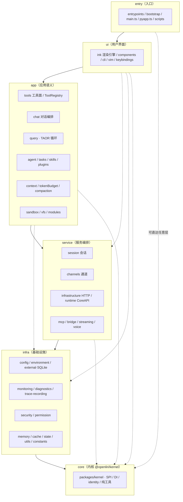
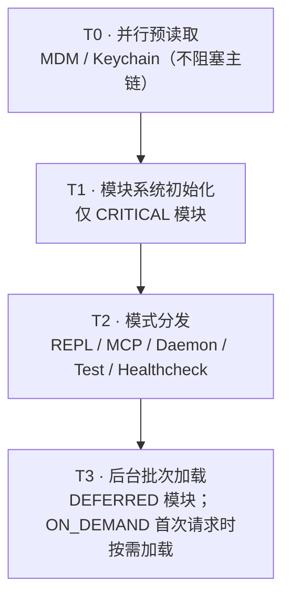
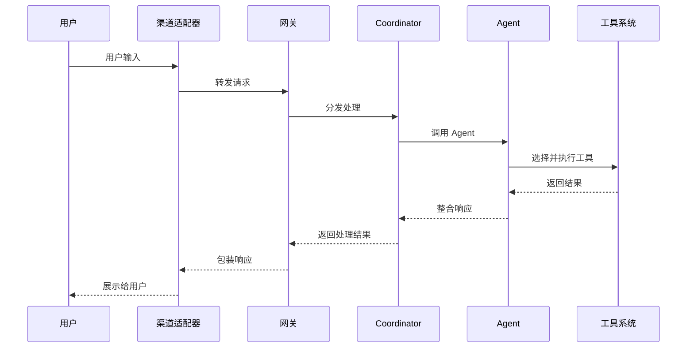

# 系统架构

## 整体架构（六层 · 与 `lint:arch` 同一口径）

> 下面这张图与门禁**同一套词汇**：层的名字、顺序与依赖方向都来自
> `scripts/modules-to-layers.json`（`layerOrder` + `allowedDependencies`）。
> `bun run lint:arch` 报出「service → ui 反向依赖」时，可直接在下图找到对应的两层。
>
> **依赖只允许向下**（右侧列即该层允许 import 的层；表内无的依赖一律视为违规）：

**各层允许的 import 边界**（照抄 `allowedDependencies`，改动须先改该 JSON）：

| 层 | 允许依赖 | 典型内容 |
|---|---|---|
| `entry` | entry, ui, app, service, infra, core | 进程入口、启动引导、脚手架脚本 |
| `ui` | ui, app, service, infra, core | Ink/CLI 渲染、组件、键位 |
| `app` | app, service, infra, core | 对话编排、TAOR、工具、任务、Agent |
| `service` | service, infra, core | 会话、通道、HTTP/运行时 API、MCP |
| `infra` | infra, core | 配置、日志、安全、存储与驱动适配 |
| `core` | core | 内核契约（SPI/DI/identity）与零依赖工具 |

## 启动架构（T0–T3）

应用采用四阶段分层启动，核心功能先就绪、重型模块延迟加载（与 README「启动架构」同源）：

模块按优先级分三级（`LazyModuleStrategy`）：**CRITICAL** 在 T1 初始化、**DEFERRED** 在 T3
批量加载、**ON_DEMAND** 首次访问时加载。新增 CRITICAL 必须写清触发理由 —— 由
`bun run lint:critical-modules` 的棘轮守住（只减不增）。

## 架构原则

### 模块化

所有功能以模块形式组织，通过依赖注入容器管理：

- 模块间通过接口通信
- 依赖显式声明
- 支持模块热替换

### 事件驱动

使用事件总线进行模块间通信：

- 解耦消息发送者和接收者
- 支持异步处理
- 可扩展的监听器链

### 安全优先

多层次安全控制：

- 治理策略控制工具权限
- 沙箱隔离执行环境
- 审计日志记录所有操作
- 内容安全过滤

## 数据流

